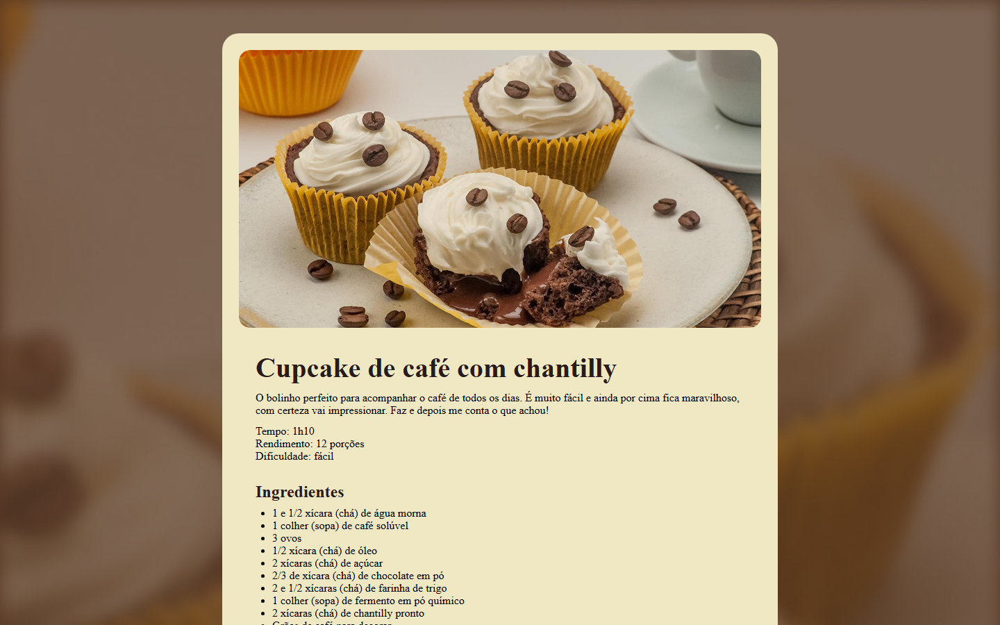

# 🧁 Página de Receita: Cupcake de Café

Página de receita de cupcake de café com chantilly, com descrição, informações de preparo, lista de ingredientes e modo de fazer.

> 📚 Projeto desenvolvido durante o curso da **Rocketseat**. Layout criado pela Rocketseat, código desenvolvido por mim.

🔗 **Acesse o projeto:** [caioviananog.github.io/projeto-pagina-receita](https://caioviananog.github.io/projeto-pagina-receita/)



## 🛠️ Tecnologias

- HTML5
- CSS3

## ✨ Funcionalidades

- Imagem de destaque da receita
- Informações de tempo, rendimento e dificuldade
- Lista de ingredientes e modo de preparo
- Fundo com imagem desfocada

## 📚 O que aprendi

- Estruturar conteúdo com títulos, parágrafos e listas em HTML
- Usar imagens de fundo e bordas arredondadas com CSS
- Organizar o layout em um card centralizado
- Publicar um site com GitHub Pages

## 🚀 Como rodar localmente

1. Clone o repositório:
   ```bash
   git clone https://github.com/CaioVianaNog/projeto-pagina-receita.git
